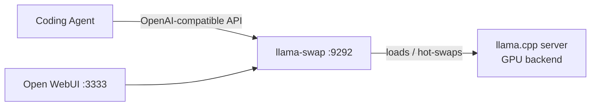

# kwisatz - Private AI Server Setup Automation made easy

> **New Ubuntu machine (e.g Nvidia DGX Spark, AMD Strix Halo) → working local-LLM inference server. Two YAML files. One command.**

A proper inference server is ten install projects wearing a trench coat — GPU toolchain, inference engine, model proxy, web UI, hardened SSH, firewall, monitoring, backup automation and many more. Done by hand, it's a whole weekend of plumbing before your first token gets generated.

**kwisatz** is a repo of modular, idempotent scripts plus one orchestrator that turns a fresh **Ubuntu** box into a machine that actually *serves* models — and it's replayable on every machine you buy next.

```bash
git clone https://github.com/Kubementat/kwisatz.git
cd kwisatz
cp machine-config-inference.yml.example machine-config.yml
cp models.yml.example models.yml
curl -LsSf https://astral.sh/uv/install.sh | sh   # one-time: the orchestrator needs uv
./kwisatz apply
```

That's it. You get llama.cpp compiled for your GPU, llama-swap hot-swapping models at `:9292`, a ChatGPT-style web UI at `:3333`, dashboards at `:3100` — with hardened SSH and UFW firewall rules on the way.

**Two configuration files, two concerns:**

| File | Purpose |
|------|---------|
| `machine-config.yml` | **Infrastructure** — which services to install, their env vars & args |
| `models.yml` | **Model catalog** — which LLMs to download, serve, and wire into coding agents |

Both are YAML-driven and fully documented below.



**What you get:**

- **Modular & idempotent** — every `tasks/*.sh` (and `tasks/*.py`) task is self-contained; safe to re-run, safe to run alone
- **Your config is the runbook** — enable/disable services and set env vars & args in one YAML file
- **Order guaranteed** — scripts run in the order you listed them; a failing script stops the run (fix the cause and re-run)
- **Agent-friendly** — ships an [Agent Skill](https://agentskills.io) so Claude Code, pi, or any compatible agent can set the machine up for you
- **Backup-solution** - ships with the repository (see [Backups](README.md#backups))
- **Not just inference** — 50+ automations: Forgejo, Nextcloud, Matrix team chat ([README_MATRIX.md](README_MATRIX.md)), n8n, Postiz, Neovim, monitoring, remote desktop, mesh VPN for remote LAN access ([README_NETBIRD.md](README_NETBIRD.md)), Text-to-speech, dev tools, and more
- Licensed under MIT License (see [MIT-LICENSE](./MIT-LICENSE))

---

## Quick Start with an AI Agent

This repository ships an [Agent Skills](https://agentskills.io)-compatible skill that gives any compatible AI agent (Claude Code, pi, etc.) full context about the available automations, how to configure them, and how to run them.

Point your agent at the skill file:
```
Read and execute the instructions in ./skills/kwisatz-assistant/SKILL.md
```

The agent will read the README and discover available scripts on its own, then guide you interactively through choosing, configuring, and running the right setup for your machine.

To *use* the OmniVoice TTS API (speech synthesis, voice registration) instead of setting up services, point your agent at `skills/omnivoice-tts/SKILL.md`.

---

## Quick Start
1. **Clone the repository** (or download a zip) and `cd` into it:
   ```bash
   git clone https://github.com/Kubementat/kwisatz.git
   cd kwisatz
   ```
2. **Make sure you have sudo rights** - all scripts call `sudo` where required, and `kwisatz apply` asks for the password once up front when your `sudo` needs one. Install [uv](https://docs.astral.sh/uv/) (the only prerequisite of the orchestrator): `curl -LsSf https://astral.sh/uv/install.sh | sh`
3. **Copy the example configurations** and edit it to enable the services and models you want:
   ```bash
   cp machine-config.yml.example machine-config.yml
   cp models.yml.example models.yml
   ```
   Or let the CLI do it for you: `./kwisatz init` copies the example and then runs `doctor`.
   The orchestrator reads `machine-config.yml` by default (or pass `--data config=<file>` to use a different one).
   Open `machine-config.yml` and set `enabled: true` for the scripts you'd like to install. See the [Configuration](#configuration) section below for the YAML format.
4. **Run the orchestrator**:
   ```bash
   ./kwisatz status   # preview what's enabled, in run order
   ./kwisatz apply    # install all enabled services
   ```
   Run `./kwisatz` without arguments to see the command map.
5. **Install one service only** — this is what the CLI is for, and it is the same code path,
   so you are not editing the config and hoping nothing else moved:
   ```bash
   ./kwisatz status
   ./kwisatz apply traefik
   ```
6. **Watch the output** - scripts run non-interactively; they print progress and final status messages. The run stops at the first failing script.
7. **What the run leaves behind** depends on what you enabled — `status` above is the
   honest answer, so read its list before judging the result. The bare
   `machine-config.yml.example` enables only `setup-basics`, so a default run gives you
   tools and nothing else. Docker (`docker run hello-world`), sshd on its custom port,
   and UFW come from `setup-docker`, `setup-sshd` and `configure-firewall`; the inference
   stack (`:9292`, `:3333`, `:3100`) comes from `machine-config-inference.yml.example`.

---

## Using the `kwisatz` CLI

`kwisatz` is one command over the same orchestrator: it discovers what you can install, runs
exactly one service through the sanctioned code path, and prints every result as JSON when an
agent is asking. Nothing here is a second implementation of `apply`: each target is executed by
`deploy.py`, the pyinfra deploy the CLI starts — the CLI plans the run and
then starts the deploy, so a single-target apply cannot install something different from a full
one (a conformance test asserts the `(command, env, stdin)` triple either way).

```bash
./kwisatz init            # first run: create machine-config.yml from the example, then doctor
kwisatz status            # what will run, in order, with env keys and the real command line
kwisatz apply             # provision everything enabled (stops at the first failure)
kwisatz apply traefik     # install/update just traefik — same env, no config edit needed
kwisatz services          # what is running right now, and whether it is healthy
kwisatz doctor            # OS, sudo, uv, docker, GPU, disk, port collisions, unhealthy stacks
kwisatz config enable vllm  # flip one flag; comments and ordering survive byte-for-byte
```

Every command works from a fresh checkout with zero install (`./kwisatz …`, or install the
launcher with `./kwisatz install`). `kwisatz --help` is generated from the command table, so
help, `kwisatz commands --json` and the dispatcher cannot disagree.

For scripts and agents: `--json` prints exactly one JSON document on stdout (progress goes to
stderr), and the exit code means the same thing in every command —
`0` ok, `1` task failed, `2` usage, `3` config/unknown target, `4` prerequisite missing,
`5` unhealthy stack or timeout, `8` partial (`--keep-going`), `9` another run holds the lock.
`6` and `7` are reserved — published in `kwisatz commands --json`, but no v1 command returns
them. Full contract:
[`docs/features/kwisatz-cli-specification.md`](docs/features/kwisatz-cli-specification.md) §8–§9.

```bash
# the whole CLI, as data — no README reading required
./kwisatz commands --json | jq '.result.commands[].name'

# install one target and report the outcome
./kwisatz apply traefik --json | jq '{ok, exit_code, items: [.result.items[] | {target, status}]}'

# what is running, for a dashboard or an agent
./kwisatz services --json | jq '.result.items[] | {name, manager, state, ports}'
```

The task scripts under `tasks/` remain the implementation: `kwisatz` never runs `apt`,
`docker` or `systemctl` itself, it only executes them with the contract the orchestrator has
always used. When a script needs arguments the CLI cannot know, send them through verbatim:
`kwisatz run forgejo -- --force`.

---

## How It Works
- **Orchestrator** — one engine. `kwisatz apply` / `./kwisatz apply <target>` plans the run, then
  executes each target with a pyinfra deploy of the checkout
  (`deploy.py -y -vvv --data select=<name>`), so the command, the environment and the stdin of
  every task are the ones [pyinfra](https://docs.pyinfra.com/en/3.x/) defines. Both read
  `src/kwisatz/orchestrator.py`, which defines what runs,
  in what order, and with which environment, so nothing can drift. `kwisatz status` previews the
  plan; task output is streamed live and written whole to `logs/kwisatz-<ts>-<target>.log`
  (mode 0600).
- **Modular task scripts** - Each `tasks/*.sh` task is self-contained and idempotent; it can be run individually or through the orchestrator. A Python task (`tasks/*.py`, e.g. `sync-models`) is dispatched the same way.
- **Configuration via YAML** - `machine-config.yml` declares which scripts to run, their environment variables, and command-line arguments. All tunable values have sensible defaults and can be overridden.
- **Re-run policy: converge by default** - Re-running a task script against an existing stack converges it: config is re-rendered, existing secrets are reused, and `docker compose up -d` reconciles only what changed — no tear-down, no silent skip. Divergence that cannot be applied to a running stack is printed with the exact re-create command (see `specification/project/conventions.md` → *Re-run policy: converge by default*).

## Configuration

This project uses **two YAML configuration files**, each governing a different concern:

| File | Controls |
|------|----------|
| `machine-config.yml` | Which **services** to install, their env vars & args (infrastructure) |
| `models.yml` | Which **LLMs** to download, serve, and wire into coding agents (model catalog) |

### Infrastructure Config (`machine-config.yml`)

The orchestrator reads `machine-config.yml` to determine which setup scripts to run. A fresh copy is provided as `machine-config.yml.example` — copy it to `machine-config.yml` before running `./kwisatz apply`:

```bash
cp machine-config.yml.example machine-config.yml
```

A pre-configured inference stack is also available as `machine-config-inference.yml.example`,
which enables the scripts needed for local LLM inference (llama.cpp, llama-swap, Open WebUI, vLLM, etc.).

### YAML Format

```yaml
version: 1

scripts:
  setup-llama-cpp:
    enabled: true
    description: Build and install llama.cpp with CUDA/Metal support
    env:
      LLAMA_CPP_CUDA: 'true'
      LLAMA_CPP_BUILD_TESTS: 'false'
    args:
      - --force
      - --jobs 8
  setup-openwebui:
    enabled: false
    env: {}
    args: []
```

**Top-level structure:**
- `version` — config format version (currently `1`)
- `scripts` — a map of script name → configuration

**Script configuration:**
- `enabled` — set to `true` to run this script, `false` to skip it
- `description` — human-readable description (informational)
- `env` — key-value pairs passed as environment variables to the script
- `args` — command-line arguments passed to the script

All scripts are **disabled by default** — enable only the ones you need.

**A key with nothing under it means "none", not "wrong".** `args:` with no list below it —
usually because the actual flags are left commented out, like the `# - --force` in the
example configs — is the same as `args: []`, and likewise `env:` is the same as `env: {}`.
Both entrypoints used to read it that way (`.args // []`, `.env // {}`), so leaving the key
blank is not a mistake you have to fix.

**Only an enabled script is checked hard.** A wrong type in a script you switched off
(`args: --force` as a bare string, say) gets a `--> WARNING:` and is otherwise ignored — a
disabled entry cannot change what this run does, so it does not stop it. The entry's shape
is always checked: a script entry that is not a mapping at all is an error naming the
script, never a traceback.

**`enabled` is a YAML boolean, and only these spellings mean anything:** `true`/`True`/`TRUE` run
the script, `false`/`False`/`FALSE` (or no `enabled` key at all) skip it. Anything else — `yes`,
`on`, `1`, an empty value — is *not* a boolean in YAML and skips the script, and the orchestrator
prints `--> WARNING: <script>: ...` so you can see why. Prefer the lowercase spellings; the
others only exist so configs written for the old yq-based orchestrator keep working, and each one
is reported with a warning asking you to fix it. An entry that is not a mapping at all (say
`setup-foo: enabled`) is a hard error naming the script, not a traceback.

**Entrypoint resolution (`.sh` and `.py`):** the key resolves to `tasks/<name>.sh`, or to
`tasks/<name>.py` when that `.sh` is absent — so a Python task such as `sync-models` is
enabled exactly like a shell task. The `.sh` wins when both files exist, and you get a
`--> WARNING:` saying which one ran. A key with neither file is a hard error naming the
script, caught by `status`; a `.py` task runs under the orchestrator's own interpreter,
so it imports the project's dependencies (`pyyaml`) instead of depending on the host's
system python. Every other rule below — `INTERACTIVE=false`, `stdin=/dev/null`, `env:`,
`args:`, config order, stop-at-first-failure — applies to both kinds.

**SSH / firewall ordering (lockout avoidance):** `setup-sshd` must run
**before** `configure-firewall`. sshd moves to the new port first, and the
firewall then allows that port. With the order reversed, UFW goes to
default-deny around a port sshd is not listening on and the next reconnect
cuts you off the machine. (`machine-config.yml.example` ships in this order —
keep it when copying to `machine-config.yml`.)

### Running the deploy by hand

Use the CLI (`./kwisatz status` / `./kwisatz apply`). What is under the hood is pyinfra itself,
called directly:

```bash
uv run pyinfra @local deploy.py --dry                          # the whole plan, nothing executed
uv run pyinfra @local deploy.py -y -vvv                        # = ./kwisatz apply
uv run pyinfra @local deploy.py -y -vvv --data select=traefik  # = ./kwisatz apply traefik
```

- `--data config=<file>` — Path to a YAML configuration file (default: `machine-config.yml` in the repository root)
- `apply` runs the enabled scripts in config order and **stops at the first failing script** (exit code 1); the scripts after it do not run. Fix the cause and re-run — scripts are idempotent.
- `status` is read-only and lists only the enabled scripts; read the YAML for disabled ones and for env/args.
- No log file is written — append `2>&1 | tee apply.log` when you want one.
- **`apply` echoes every command line** (it runs pyinfra at `-vvv`, the only level that streams task output). Configured `env:` values are printed as `export KEY=*MASKED*` — pyinfra masks them and executes the real value — but script names, `args:` and all task output are echoed verbatim. Treat `machine-config.yml` as a public file anyway: it is read as plain text by anything on the box, so keep credentials in the `/srv/<service>/.env` files the task scripts manage, not in an `env:` block.
- Every task runs with `INTERACTIVE=false` and `stdin=/dev/null`, so a stray prompt fails fast instead of hanging. When a script must prompt, ask for it explicitly: `./kwisatz apply forgejo --interactive` hands the script your terminal (it needs a TTY) and keeps the rest of the contract. Running the script by hand — `INTERACTIVE=true tasks/setup-forgejo.sh` — still works, but it skips the config's `env:`/`args:` and the ordering, which is why the CLI exists. A per-script `env:` entry `INTERACTIVE: "true"` also overrides the default, with stdin left as `/dev/null`.
- **Sudo is settled once, before the first script.** Every task script escalates with `sudo`, and it
  cannot ask you for the password: the deploy runs with `stdin=/dev/null`, and `sudo` reads a
  password from the controlling terminal rather than from stdin. `apply` therefore checks the ticket
  the same way a script would and, if it is missing, asks you once with `sudo -v`, on your own
  terminal — then holds it open for the rest of the run (`sudo -n true` every 3 minutes, because a
  long single install used to expire mid-script). Nothing is stored: the password goes from sudo's
  prompt into sudo, never into a
  process, a pipe, `argv`, or a file. `--json` runs never prompt (they get the verdict),
  `--no-sudo-warmup` leaves sudo alone, and an exported `SUDO_ASKPASS` answers this prompt when no
  terminal is attached. The scripts run in their own *process group* but the *same session* as your
  terminal — the group is what the timeout kills, and the session is what lets the ticket you
  primed reach them. If no ticket can be had the run stops with exit `4` and the reason — no
  terminal to ask
  on, a refused password, or sudo holding a ticket the scripts cannot see. That last one is not
  fixed by `sudo -v` again: run `apply` from the login terminal that primed it, or make the ticket
  session-independent with `Defaults timestamp_type=global` in `/etc/sudoers.d`. `--interactive`
  does not change any of this: it gives a script your stdin, which is enough for its own `read`
  prompt but not for `sudo`'s.
- **What the task script sees in its environment**: pyinfra exports *only* `INTERACTIVE=false` plus that script's `env:` block (`export KEY=value && bash tasks/<name>.sh` — `python tasks/<name>.py` for a Python task), and it does not merge `os.environ` into that list — but the command still runs as a child of the shell that started the run, so the script also inherits the ambient environment (`PATH`, `HOME`, anything you export yourself). `deploy.py` drops `VIRTUAL_ENV` and the venv's `bin` from `PATH` before handing off, so tasks use the system `python3`/`pip` instead of the orchestrator's venv. A per-script `env:` therefore adds and overrides variables; it never hides the ambient ones, and it always wins over `INTERACTIVE=false`.

An unparsable `machine-config.yml` makes `kwisatz status` exit `3`, where the raw pyinfra deploy
exited `1`. The CLI's exit codes are a contract — script against `./kwisatz <cmd> --json`, and see
`specification/features/kwisatz-cli/behaviors.md` § Behavior 7.

---

## Service Setup Scripts (`tasks/`)

All service setup scripts are located in the `tasks/` directory. A config key names one of
them by its basename: `tasks/setup-docker` runs `setup-docker.sh`, `sync-models` runs
`sync-models.py`. Most are `.sh`; the model-catalog sync is the one Python task, and it is
enabled exactly like a shell task (`INTERACTIVE=false`, its `env:` and `args:`, config
order, stop-at-first-failure).

For a complete list of automations see [AUTOMATIONS.md](AUTOMATIONS.md)

**Setting up network access?** [README_TRAEFIK.md](README_TRAEFIK.md) covers the reverse
proxy; [README_NETBIRD.md](README_NETBIRD.md) is the flow guide for reaching your local
network from outside the LAN — a phone on mobile data, a roaming laptop — over a
self-hosted NetBird mesh, and it documents `setup-netbird.sh` and its routing peer.

---

## Backups

Encrypted (AES-256), deduplicated, incremental backups of a machine — including
**consistent** backups of Docker-based databases — using plain BorgBackup:

| Script | Role |
|--------|------|
| `tasks/setup-backup-server.sh` | Makes one machine the storage host **and** starts a working self-backup: installs borg, prepares storage (a mounted drive, or a local dir on the main fs when none is present), creates the per-client repo layout, then runs the client in local mode |
| `tasks/setup-backup-client.sh` | Adds any machine to the fleet: auto-detects scope + Docker services (or use `--paths`/`--services`), inits its repo (remote over SSH or local), generates passphrase + wrapper (from `templates/backup-client/`) + daily systemd timer; with `--services` dumps stateful Docker databases (`pg_dump`/`mysqldump`/`sqlite3 .backup`/`forgejo dump`) into each archive before `borg create` |

```bash
# 1. Zero-config: one command → working self-backup (local-disk mode)
./tasks/setup-backup-server.sh

# 2. A remote client, with consistent Docker DB dumps, initial full run
sudo ./tasks/setup-backup-client.sh --client mybox --host backup.example.com \
     --user alice --repo-path /var/backups/automatic \
     --paths "/home/alice /etc /srv" --services "forgejo,planka,kestra" --initial

# Manage: sudo /usr/local/bin/borg-backup-mybox <create|list|check|restore|restore-db>
```

> **Prerequisites:** a bare run stores backups in a local directory on the main
> disk (`/var/backups` — protects against software corruption, not disk failure);
> for disk-failure protection mount a separate drive first (or set `BACKUP_MOUNT`
> to an already-mounted, fstab-persistent path — the server script only verifies,
> never formats or mounts). Remote clients need key-based SSH to the server first
> (`ssh-copy-id`); with `--services`, the daily timer runs as the backup user,
> which therefore needs access to the Docker daemon (user in the `docker` group —
> `setup-docker.sh` adds it); for `nextcloud` the client also adds it to the
> `www-data` group so the 0770 user-file dir is readable. The generated repo passphrase is the **only** way to
> read a backup — move `~/.config/borg/<client>.pass` to a password manager when
> prompted.

Verify any time with `--check` on either script (both exit non-zero on problems;
client `--check --full` adds a slow integrity check). Day-to-day management goes
through the generated wrapper `/usr/local/bin/borg-backup-<client>`; its
`restore-db <snapshot> <service> --yes` restores one
service's database from its dump (destructive). Details and the per-service
dump matrix: [AUTOMATIONS.md → Backup](AUTOMATIONS.md#backup), spec:
[specification/features/setup-backup-server.md](specification/features/setup-backup-server.md),
research: [docs/research/docker-volume-backup-research.md](docs/research/docker-volume-backup-research.md).

---

## Model Catalog & Model Sync (`sync-models`)

Besides installing the stack, this repository supports **configuring LLMs on an already-provisioned inference server** via a declarative **model catalog** (`models.yml`) and the Python sync tool [`tasks/sync-models.py`](tasks/sync-models.py) (the `sync_models/` package).

> **Relationship to `machine-config.yml`:** `machine-config.yml` controls *which services to install* (infrastructure). `models.yml` controls *which models to download and serve* (content). After running `./kwisatz apply` with `setup-llama-swap`, `setup-pi`, and `setup-opencode` enabled, you use `models.yml` to populate the inference server with actual models.

### Two-stage workflow

1. **Fresh box** — after `setup-llama-swap.sh`, `setup-pi.sh` and `setup-opencode.sh`, just run `./tasks/sync-models.py`. The committed `models.yml.default` is a real, downloadable local model set, so a local model works out of the box (it is downloaded via the `hf` CLI and served by llama-swap).
2. **Remote providers** — add external OpenAI-compatible providers with real API keys later: `cp models.yml.default models.yml`, edit `apiKey`/models, and re-run the tool — the agent provider blocks converge to the catalog on the next run.

### Getting started

```bash
# 1. Copy the default catalog (contains a real, downloadable model)
cp models.yml.default models.yml

# 2. Run the sync tool (downloads weights, configures llama-swap + agents)
./tasks/sync-models.py

# Or use a custom catalog path:
MODELS_YML=/path/to/my-catalog.yml ./tasks/sync-models.py

# Or only update agent configs (skip llama-swap):
./tasks/sync-models.py --agents-only
```

**Catalog resolution order:** `$MODELS_YML` → `models.yml` → `models.yml.default`

`models.yml` is **gitignored** (it may contain API keys). `models.yml.default` and `models.yml.example` are committed — copy whichever suits your needs.

### Catalog Schema (`models.yml`)

```yaml
# Environment variables expanded into download/serve commands.
# Reserved names (PORT, MODEL_ID, PID) may not be used here.
env:
  - name: MODEL_DIR
    value: ${HOME}/.cache/huggingface/hub

providers:
  - name: local
    baseUrl: http://localhost:9292/v1
    apiKey: sk-replace-with-your-key
    models:
      - name: qwen3.8-27b
        type: local          # or "remote"
        env:                 # optional per-model env (extends top-level)
          - name: EXAMPLE_FLAG
            value: "--flash-attn on"
        download:            # required for type: local (list of shell cmds)
          - >-
            hf download
            hf://unsloth/Qwen3.8-27B-GGUF/Qwen3.8-27B-UD-Q4_K_M.gguf
            --local-dir ${MODEL_DIR}/unsloth/Qwen3.8-27B-GGUF
        serve:               # required for type: local
          cmd: |
            ${llama-server-bin}
            --port ${PORT}
            -m ${MODEL_DIR}/unsloth/Qwen3.8-27B-GGUF/Qwen3.8-27B-UD-Q4_K_M.gguf
            --ctx-size 128000
            --jinja
        agent:               # optional — agent metadata defaults below
          contextWindow: 262144
          maxTokens: 32000
          reasoning: true
          input: [text, image]
          thinkingLevelMap:
            minimal: null
            low: low
            medium: medium
            high: null
            xhigh: xhigh
            max: null

  - name: remote
    baseUrl: http://192.168.0.57:9292/v1
    apiKey: sk-remote-key
    models:
      - name: qwen3.8-27b
        type: remote         # no download/serve allowed
        agent:
          contextWindow: 262144
          maxTokens: 32000
          reasoning: true
```

**Schema rules:**

| Level | Key | Required | Description |
|-------|-----|----------|-------------|
| Top | `env` | No | Variables expanded into download/serve commands |
| Top | `providers` | Yes | List of provider blocks |
| Provider | `name` | Yes | Provider identifier |
| Provider | `baseUrl` | Yes | OpenAI-compatible API base URL |
| Provider | `apiKey` | No | API key (omit if no auth) |
| Provider | `models` | Yes | List of model blocks |
| Model | `name` | Yes | Model name (unique within local llama-swap namespace) |
| Model | `type` | Yes | `local` or `remote` |
| Model | `env` | No | Per-model env vars (extends top-level `env`) |
| Model | `download` | Local only | Shell commands to download weights |
| Model | `serve` | Local only | llama-swap serve command (`cmd` field) |
| Model | `agent` | No | Agent metadata (all fields optional) |
| Agent | `contextWindow` | No | Default `200000` |
| Agent | `maxTokens` | No | Default `16000` |
| Agent | `reasoning` | No | Default `true` |
| Agent | `input` | No | Default `[text]` |
| Agent | `thinkingLevelMap` | No | Maps thinking levels to model params (`null` = disabled) |

**Type rules:**
- `type: local` — requires non-empty `download` and `serve.cmd`. Sync downloads weights via `hf` CLI and merges the serve command into llama-swap config.
- `type: remote` — must NOT define `download`/`serve`. The provider serves weights elsewhere; only agent metadata is consumed.

**Variable expansion:**
- `${MODEL_DIR}` and any `env:` entry are expanded by sync into download/serve commands
- `${llama-server-bin}` is a llama-swap macro from the live config (left verbatim)
- `${PORT}` is a reserved llama-swap macro
- Long `-m` paths may use backslash line continuation

### Sync Configuration (environment variables & flags)

| Variable / Flag | Default | Purpose |
|-----------------|---------|---------|
| `MODELS_YML` | — | explicit catalog path; resolution: `$MODELS_YML` → `models.yml` → `models.yml.default` |
| `LLAMA_SWAP_CONFIG` | `/srv/llama-swap/config/config.yaml` | llama-swap config path |
| `PI_MODELS_JSON` | `$HOME/.pi/agent/models.json` | pi model config path |
| `OPENCODE_CONFIG` | `$HOME/.config/opencode/opencode.json` | opencode config path |
| `LLAMA_SWAP_HEALTH_TIMEOUT` | `500` | post-restart health poll timeout in seconds |
| `--no-restart` | — | do not restart llama-swap even if its config changed |
| `--agents pi,opencode` | all detected | restrict agent sync to the listed agents |
| `--agents-only` | — | only update agent model configs (skip llama-swap + downloads) |

> **Idempotency:** re-runs are no-ops — the tool is strictly additive. It adds missing entries and fixes managed fields, never removes or rewrites entries it does not own.
>
> **Deprovisioning:** removing a model from the catalog does **not** remove its entries from the agent/llama-swap configs — edit those manually.

---

## Customization & Environment Variables

There are two ways to customize the setup:

1. **Edit `machine-config.yml`** — Set environment variables and command-line arguments for each script in the configuration file. This is the recommended way for declarative, reproducible setups.
2. **Edit default values directly** in each task script (e.g., change `LM_STUDIO_VERSION="0.4.0-18"` in `setup-lm-studio.sh`). This is handy for a permanent change across all runs.

---

## Troubleshooting & FAQ
1. **`sudo: command not found`** - Ensure you run the scripts on a system where `sudo` is installed (Ubuntu default). You must have a user with sudo privileges. If `apply` exits `4` on the sudo prerequisite, run `sudo -v` in this shell and repeat it. The password itself is asked for once by `apply` before the first script runs. If `apply` says the ticket it found is not one the scripts can use, `sudo -v` here cannot fix that: run it from your login terminal, or set `Defaults timestamp_type=global` in `/etc/sudoers.d` so sudo stops keying the ticket on one session.
2. **Docker fails to start** - After `setup-docker.sh`, verify group membership:
   ```bash
   groups $USER | grep docker && echo "User is in docker group"
   # If not, log out/in or run: newgrp docker
   ```
3. **Port conflicts** - If a port (e.g., `2224`) is already used, export a different value before running the scripts.
4. **UFW refuses to enable** - Check if another firewall manager (e.g., `firewalld`) is active; disable it or stick with UFW for this automation.

---

## Additional Documentation
- **[README_TRAEFIK.md](README_TRAEFIK.md)** - Complete guide for the Traefik v3 reverse proxy setup script (`setup-traefik.sh`)
- **[README_NETBIRD.md](README_NETBIRD.md)** - Making a local network reachable from the outside with self-hosted NetBird (routing peer, dashboard objects, verification)
- **[README_MANAGING_MODELS.md](README_MANAGING_MODELS.md)** - Guide for managing models via huggingface cli
- **[tests/README.md](tests/README.md)** - Test suite documentation and usage guide
- As `kubementat` is a term leaning on Frank Herbert's Dune universe this project is also [referencing dune terminology](https://dune.fandom.com/wiki/Kwisatz_Haderach).
---

## Contributing
Feel free to fork this repository and add new task scripts (e.g., for additional AI tools) or improve existing ones. When adding a script:
- Place it under `tasks/` if it is part of the core provisioning flow, otherwise put it in an appropriate sub-folder.
- Place templates for automation scripts in `templates/`.
- Document any environment variables at the top of the file.
- Update this README (or add a new section) describing the purpose and usage.

## About the creators

We are the [AI-Crack-Heads](https://www.ai-crack-heads.com) , an agency specialized in AI Consulting, project planning, execution and operations.
If you need assistance with AI or DevOps projects [reach out to us](https://www.ai-crack-heads.com/en/contact).
